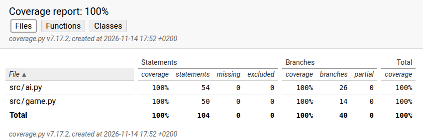

# Testausraportti

## Yksikkötestit
Yksikkötesteissä on käytetty unittest-kirjastoa. Testit kattavat pelilogiikan (game.py) sekä tekoälyn heuristiikan ja logiikan (ai.py).

**Testikattavuusraportti**

Testikattavuus on mitattu coverage-työkalulla.
Testit ajettu 14.11.2026
