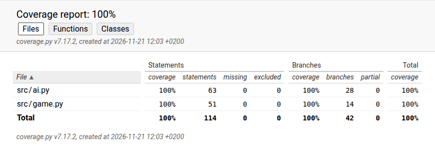

# Testausraportti

## Yksikkötestit
Yksikkötesteissä on käytetty unittest-kirjastoa. Testit kattavat pelilogiikan (game.py) sekä tekoälyn heuristiikan ja logiikan (ai.py).

**Testikattavuusraportti**

Testikattavuus on mitattu coverage-työkalulla.
Testit ajettu 21.11.2026

## Käyttöliittymätestaus
Käyttöliittymän testaus on toteutettu manuaalisesti valmiita testitapauksia hyödyntäen. Manuaalitestauksessa keskitytään erityisesti käyttöliittymän toimivuuteen ja käytettävyyteen.

**Testitapaukset**
1. Pelin aloitus ja perussiirrot
- Aloitus: Avaa sivu tyhjällä/uudella sessiolla. Sivulle pitäisi avautua 4x4-pelilauta, jossa on kaksi aloituslaattaa ja pisteet ovat 0.
- Kelvollinen siirto: Paina siirtosuuntaa. Laattojen pitäisi siirtyä painettuun suuntaan ja yhdistyä, jos on mahdollista. Lisäksi uusi laatta pitäisi ilmestyä tyhjään ruutuun ja pisteiden kasvaa, jos laattoja yhdistyi.
- Lukkiutunut suunta: Kokeile suuntaa, johon mikään laatoista ei voi liikkua eikä yhdistyä. Laudan ei pitäisi muuttua, eikä uutta laattaa ilmestyä tai pisteiden kasvaa.
- AI-siirto: Paina 'Pyydä tekoälysiirto (AI)'-nappia eri kohdissa peliä (kun laudalla on eri määrä tyhjiä ruutuja). Tekoälyn pitäisi tehdä järkevä siirto ja vasteajan pitäisi tuntua sopivalta. Myös loppupelissä, kun lauta on täydempi niin järkevä siirto pitäisi syntyä edelleen suhteellisen sulavasti. Peli ei saa jäädä etenkään myöhemmässä vaiheessa (kun hakusvyys on isompi) jumiin tai aiheuttaa virheitä.

2. Game over ja uudelleen käynnistys
- Vie peli tilanteeseen, jossa pelilauta on täynnä eikä siirroilla voi enää muuttaa lautaa. Pisteiden alapuolelle pitäisi ilmestyä Game over -banneri ja siirtonappien pitäisi olla poissa käytöstä. 'Aloita alusta'-nappi on ainoa aktiivinen nappi.
- Uudelleen käynnistys: Paina 'Aloita alusta'-nappia. Game over -bannerin pitäisi kadota, pisteiden ja pelilaudan nollautua(/palata aloitustilaan). Kaikkien siirtonappien pitäisi olla käytettävissä.
- Sivun päivitys: Päivitä sivu kesken pelin. Pelin pitäisi säilyä ennallaan eli pelilautaan, pisteisiin tai muuhunkaan ei tule muutoksia.
